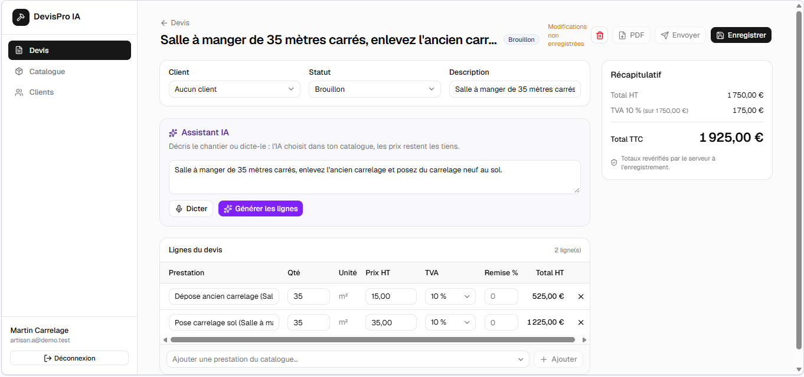
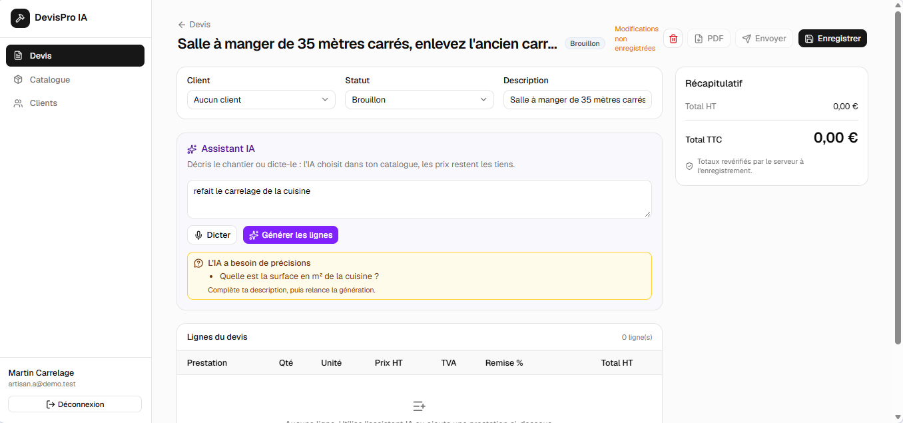
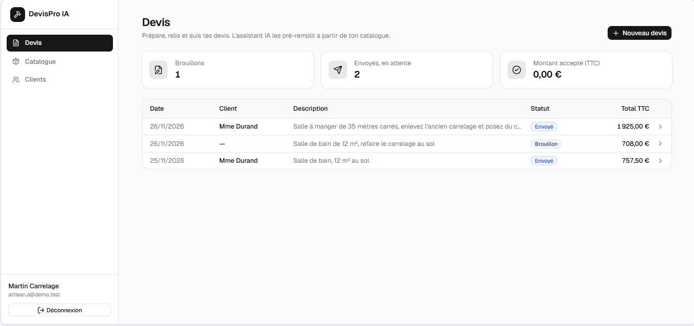
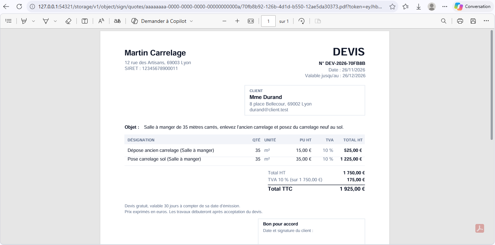
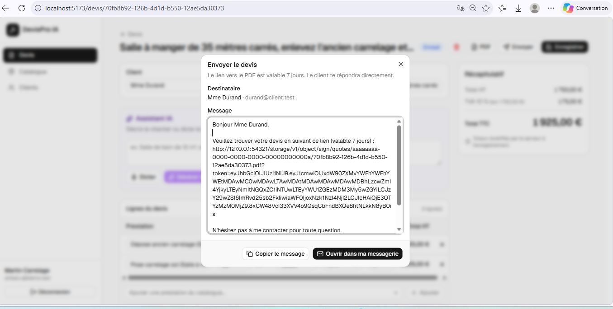
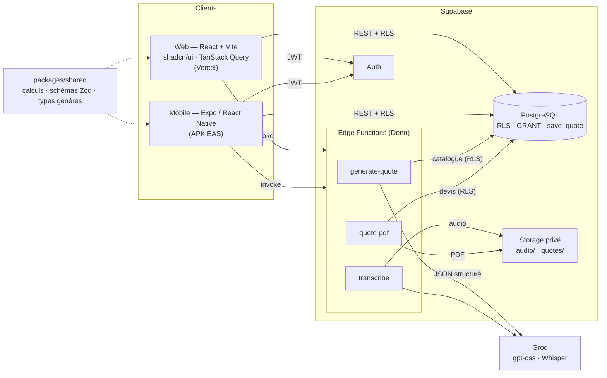
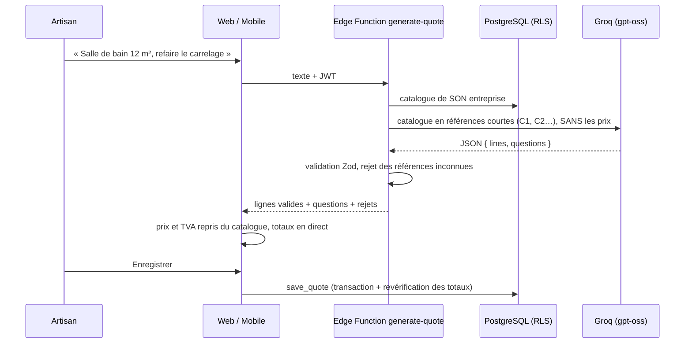

# DevisPro IA

> Un artisan décrit son chantier — en le tapant ou en le dictant — et obtient un devis chiffré à partir de **son propre catalogue de prestations**, prêt à relire, enregistrer et envoyer.

[](https://github.com/ZouariAhmedNour/devispro-ia/actions/workflows/ci.yml)

<p align="center">
  
</p>

<!-- Si tu as créé le GIF, remplace l'image ci-dessus par :
<p align="center">
  
</p>
-->

| | |
|---|---|
| 🌐 **Démo web** | https://devispro-ia-weld.vercel.app |
| 📱 **App Android (APK)** | [Télécharger l'app](https://expo.dev/accounts/lezouaris-team/projects/devispro-ia/builds/9adccf2c-e688-4bc8-b313-50582bf0be9f) · [QR code ↓](#installer-lapp-android) |
| 🎬 **Vidéo (2 min)** | LIEN_VIDEO |
| 🔑 **Comptes de démo** | `artisan.a@demo.test` / `demo1234` (Martin Carrelage) · `artisan.b@demo.test` / `demo1234` (Dubois Peinture) |

---

## Aperçu

### Web — back-office de l'artisan

<table>
  <tr>
    <td width="50%" align="center">
      <br/>
      <sub><b>L'IA pose une question</b> au lieu d'inventer une surface</sub>
    </td>
    <td width="50%" align="center">
      <br/>
      <sub><b>Suivi des devis</b> : brouillons, envoyés, montant accepté</sub>
    </td>
  </tr>
  <tr>
    <td width="50%" align="center">
      <br/>
      <sub><b>PDF généré côté serveur</b> : mentions, TVA par taux, bon pour accord</sub>
    </td>
    <td width="50%" align="center">
      <br/>
      <sub><b>Envoi au client</b> par lien signé (e-mail ou copie)</sub>
    </td>
  </tr>
</table>

### Mobile — saisie sur le chantier

<p align="center">
  
  &nbsp;
  
  &nbsp;
  
</p>
<p align="center">
  <sub>Liste des devis · Nouveau devis dicté et généré par l'IA · Détail, envoi et PDF</sub>
</p>

---

## Installer l'app Android

<p align="center">
  <a href="https://expo.dev/accounts/lezouaris-team/projects/devispro-ia/builds/9adccf2c-e688-4bc8-b313-50582bf0be9f">
    
  </a>
</p>

1. Scanne le QR code avec un téléphone **Android** (ou [ouvre ce lien](https://expo.dev/accounts/lezouaris-team/projects/devispro-ia/builds/9adccf2c-e688-4bc8-b313-50582bf0be9f) depuis le téléphone).
2. Appuie sur **Install** puis télécharge l'APK.
3. Autorise l'installation depuis cette source (l'app n'est pas distribuée via le Play Store).
4. Connecte-toi avec `artisan.a@demo.test` / `demo1234`.

> Android uniquement : une distribution iOS nécessite un compte Apple Developer payant.

---

## Fonctionnalités

- **Génération de devis par IA** : « Salle de bain de 12 m², enlever l'ancien carrelage et poser du neuf » → lignes chiffrées issues du catalogue de l'artisan.
- **L'IA pose des questions au lieu de deviner** : sans surface indiquée, elle demande la surface plutôt que d'en inventer une.
- **Dictée vocale** sur le chantier (web et mobile), transcrite par Whisper.
- **Éditeur de devis** : quantités, prix, TVA (5,5 / 10 / 20 %), remises, totaux HT/TVA/TTC en direct.
- **PDF généré côté serveur** et **envoi au client** (e-mail ou partage WhatsApp/SMS) par lien signé.
- **Multi-entreprises** : chaque artisan ne voit que ses données, garanti par la base elle-même.
- **Web** (back-office) et **mobile** (saisie terrain), sur la même base et les mêmes règles.

## Architecture



### Génération d'un devis par l'IA



## Modèle de données

```mermaid
erDiagram
    companies ||--o{ profiles : "emploie"
    companies ||--o{ catalog_items : "propose"
    companies ||--o{ clients : "a"
    companies ||--o{ quotes : "émet"
    clients ||--o{ quotes : "reçoit"
    quotes ||--o{ quote_lines : "contient"
    catalog_items ||--o{ quote_lines : "copiée dans"

    companies { uuid id PK; text name; text siret }
    profiles { uuid id PK "= auth.users.id"; uuid company_id FK }
    catalog_items { uuid id PK; uuid company_id FK; text label; text unit; int unit_price_cents; numeric vat_rate; bool active }
    clients { uuid id PK; uuid company_id FK; text name; text email }
    quotes { uuid id PK; uuid company_id FK; uuid client_id FK; enum status; int total_ttc_cents }
    quote_lines { uuid id PK; uuid quote_id FK; uuid company_id FK; text label; numeric quantity; int unit_price_cents; numeric vat_rate; numeric discount_percent }
```

Chaque table porte un `company_id`, filtré par la **RLS**. Les clés étrangères sont **composites** (`(id, company_id)`), car les contrôles de clé étrangère ignorent la RLS. Les lignes de devis **copient** le prix du catalogue : modifier un tarif ne change pas les anciens devis.

## Choix techniques clés

| Choix | Pourquoi |
|---|---|
| **RLS PostgreSQL + GRANT explicites** | La sécurité vit dans la base, au même endroit pour le web, le mobile et les fonctions. Aucun filtre à oublier côté API. |
| **Montants en centimes entiers** | `0.1 + 0.2 !== 0.3`. Aucune erreur d'arrondi sur un devis. |
| **TVA calculée par taux** | Comme sur une facture française. Évite le cumul d'arrondis ligne par ligne (testé). |
| **Totaux calculés deux fois** (TypeScript + SQL) | Le navigateur calcule pour l'affichage, le serveur pour la vérité. `save_quote` refuse tout écart d'un centime. |
| **IA : liste fermée, prix cachés, Zod** | Le LLM choisit des références (C1, C2…), jamais des prix. Toute réponse est validée, et les références inventées sont rejetées. |
| **Fournisseur LLM interchangeable** | API compatible OpenAI (`LLM_BASE_URL`, `LLM_MODEL`). Groq aujourd'hui, OpenAI ou Mistral demain, sans changer le code. |
| **PDF généré côté serveur** | Le document envoyé au client reflète la base, pas l'écran. |
| **Front par fonctionnalité + TanStack Query** | `features/{catalog,clients,quotes}` : API, hooks, composants, page. Cache et rafraîchissement automatiques. |

👉 Les 25 décisions détaillées, avec leurs alternatives et les incidents rencontrés : [**DECISIONS.md**](./DECISIONS.md)

## Qualité : 4 niveaux de tests, tous en CI

| Niveau | Outil | Ce qui est vérifié |
|---|---|---|
| Logique | **Vitest** | Calculs (arrondis, TVA par taux, remises), parsing des prix, schémas, lignes de l'éditeur |
| Base de données | **pgTAP** | Isolation entre entreprises (RLS, FK composites, anonymes), totaux SQL = totaux TypeScript |
| Edge Functions | **Deno test** | Prompt, rejet des prestations inventées, JSON invalide, erreurs fournisseur, PDF — **avec un LLM simulé** |
| Parcours utilisateur | **Playwright** | Connexion, isolation visible, génération (IA simulée) → enregistrement → persistance |

Chaque PR doit passer **4 jobs GitHub Actions obligatoires** (lint/typecheck/Vitest, pgTAP, Deno, Playwright). Les versions de Node, de la CLI Supabase et de Deno sont figées.

## Structure du dépôt

```
devispro-ia/
├─ apps/
│  ├─ web/                 React + Vite (features/, components/ui shadcn, e2e/ Playwright)
│  └─ mobile/              Expo Router (app/ = routes, src/features/ = écrans et logique)
├─ packages/
│  └─ shared/              calculs, schémas Zod, types générés depuis la base, messages
├─ supabase/
│  ├─ migrations/          schéma, RLS, GRANT, fonctions SQL, buckets Storage
│  ├─ functions/           generate-quote · transcribe · quote-pdf (Deno)
│  ├─ tests/               tests pgTAP
│  └─ seed.sql             2 entreprises de démo
├─ assets/                 captures d'écran du README
├─ DECISIONS.md
└─ .github/workflows/ci.yml
```

## Lancer le projet en local

**Prérequis** : Node 26, pnpm, Docker Desktop, Deno, une clé API Groq (gratuite).

```bash
pnpm install
pnpm supabase start                      # base locale + seed de démo
pnpm gen:types                           # types TypeScript depuis le schéma

# Clé LLM pour les Edge Functions
echo "LLM_API_KEY=gsk_..." > supabase/functions/.env
pnpm supabase functions serve --env-file supabase/functions/.env

# Web : apps/web/.env.local (VITE_SUPABASE_URL, VITE_SUPABASE_ANON_KEY — voir .env.example)
pnpm --filter web dev                    # http://localhost:5173

# Mobile : apps/mobile/.env (voir .env.example), puis scanner le QR code avec Expo Go
pnpm --filter mobile start
```

**Tests**

```bash
pnpm test                                # Vitest
pnpm supabase test db                    # pgTAP
DENO_NO_PACKAGE_JSON=1 deno test --config supabase/functions/generate-quote/deno.json supabase/functions/generate-quote/
pnpm --filter web test:e2e               # Playwright
```

## Comment j'ai travaillé avec l'IA

J'ai construit ce projet **avec un assistant IA (Claude)**, en le traitant comme un binôme, pas comme un générateur à copier-coller :

1. **Une roadmap, puis une fonctionnalité à la fois** : chaque étape partait d'un objectif précis (règles, cas limites), sur une branche dédiée, avec sa PR et une CI verte avant le merge.
2. **Tout est exécuté et vérifié** : chaque morceau de code a été lancé, testé dans le navigateur ou sur téléphone, et couvert par des tests automatisés.
3. **Les vrais problèmes apparaissent à l'exécution.** Voici ce que j'ai diagnostiqué et corrigé en cours de route :
   - des **tests pgTAP en conflit avec le seed** (mêmes UUID) → identifiants dédiés aux tests ;
   - un **`permission denied` en production** absent en local → les droits sont versionnés dans une migration (GRANT explicites) ;
   - une **CI cassée sans changement de code** (`version: latest` et limite de l'API GitHub) → versions figées ;
   - **Deno qui lisait le monorepo pnpm** et modifiait `package.json` → isolation des Edge Functions ;
   - une **validation Zod trop stricte** sur les UUID du seed, un **lien signé pointant vers le nom Docker interne**, une **limite CPU** des Edge Functions en local → corrigés et documentés ;
   - une **mauvaise clé API** sur mobile, puis une **clé `service_role` exposée par erreur** → clé régénérée immédiatement.
4. **Chaque choix est justifié par écrit** dans [DECISIONS.md](./DECISIONS.md), avec les alternatives écartées.

## Limites et évolutions

- Pas de build iOS (compte Apple Developer payant requis).
- Mentions légales du PDF simplifiées pour la démo (assurance décennale, conditions de paiement… à ajouter selon le métier).
- Envoi par lien signé ; un envoi transactionnel (Resend) avec suivi d'ouverture est une évolution possible.
- Pas de brouillon hors ligne synchronisé : les requêtes sont mises en pause hors ligne et reprennent au retour du réseau.